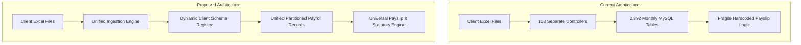
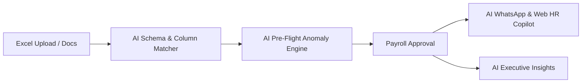

# HRS System Modernization & AI Capabilities Roadmap

An architectural assessment of the **HRS (Human Resource & Payroll Management System)** codebase, identifying existing operational bottlenecks and outlining a roadmap of **core architectural simplifications** and **high-impact AI features**.

---

## 1. Codebase Analysis & Current Bottlenecks

Across the 31 client implementations, several recurring operational bottlenecks and architectural complexities were identified:

### 1.1 Table Explosion & Schema Fragmentation
* **2,392 Monthly Client Tables**: The database creates a new physical table every month for every client (e.g., `olamtemaugust26`, `jkayaugust26`, `melcomtryfebruary25`, `twelliumaccraseptember25`).
* **Inconsistent Column Naming**:
  * Worked days: `total1`, `days_worked`, `actualdays`, `workdays`, `days`.
  * Gross compensation: `totalearn`, `gross_salary`, `grosspay`, `earnings`, `gross`.
  * Statutory deductions: `ssnit_ee`, `ssnitee`, `ssnit_5_5_percent`, `petra_5_percent`, `tier_2_ee`.
* **Consequence**: Over **168 controllers** (`*PayController`, `*SsnitController`, `*PetraController`, `*StatController`, `*SalaryPaymentController`) replicating 90% of the same business logic, leading to massive maintenance overhead.

### 1.2 Brittle Excel Ingestion
* Each client relies on a rigid, hardcoded Excel import controller. If an HR administrator or external client renames a header (e.g. changing `BASIC SALARY` to `BASE_PAY`), the import silently breaks, misaligns figures, or fails.

### 1.3 Disconnected Auditing
* Master data (`bankdetails`, `ssnit`, `petradetails`, `newemployeedata`) is separated from monthly payroll dumps.
* Reconciling discrepancies currently requires opening separate audit modules (`BankAuditController`, `SsnitAuditController`, `PetraAuditController`) and manually checking mismatches one by one.

---

## 2. Core Architectural Simplification (High-ROI Modernization)

Before or alongside AI features, standardizing core data plumbing delivers immediate stability and cuts development time by up to 80%.

### 2.1 Dynamic Client Schema Registry (Eliminate 150+ Controllers)
* **Concept**: Replace separate controllers per client with a single `PayrollIngestionService` backed by a `client_payroll_configs` table.
* **How it works**:
  * Store column mappings per client in JSON (e.g., `{"basic": ["basic_pay", "rate_amount", "salary"], "days": ["total1", "days_worked"]}`).
  * Calculation strategies are defined dynamically:
    * `standard_monthly`: Fixed Base Salary / 27 * Days Worked.
    * `tonnage_rate`: Days Worked * Daily Tonnage Rate.
    * `hourly`: Hours Worked * Hourly Rate.
* **Impact**: Eliminates over 120 redundant PHP controller files and unifies all client payrolls under a single standard pipeline.

### 2.2 Unified Partitioned Payroll Store
* **Concept**: Migrate away from generating 2,300+ monthly tables to a single partitioned table: `payroll_records`:
  * Columns: `id`, `client_id`, `payroll_period` (YYYY-MM), `staff_id`, `employee_name`, `gross_pay`, `ssnit_tier1`, `petra_tier2`, `taxable_income`, `paye`, `net_pay`, `raw_payload (JSON)`.
  * Maintain database views (e.g., `CREATE VIEW jkayaugust26 AS ...`) for zero downtime and full backward compatibility with legacy scripts.
* **Impact**: Eliminates table sprawl, simplifies global reporting, and speeds up queries significantly.

### 2.3 1-Click Payroll Pipeline Stepper
A modern, 4-step wizard interface replacing fragmented audit tabs:
1. **Upload & Ingest**: Drag-and-drop client payroll sheet.
2. **Automated Cross-Check**: Real-time validation against Employee Master records (Bank details, SSNIT numbers, Petra IDs, Ghana Card PINs).
3. **Statutory & Net Recalculation**: Instant verification of Tier 1 SSNIT (5.5%), Tier 2 Petra (5%), GRA PAYE tax brackets, and Net Pay.
4. **Approval & Bulk Distribution**: 1-click generation of bank payment files (ACH/GhIPSS/MoMo), GRA/SSNIT schedule exports, and bulk WhatsApp/Email payslips.

---

## 3. High-Impact AI Features Tailored for HRS

### 3.1 AI-Driven Intelligent Spreadsheet & Column Matcher
* **The Problem**: Different clients (OFI, Jay Kay, Melcom, Transsion, PZ Cussons) use varying column names, merged headers, or change Excel formats unannounced.
* **The AI Solution**:
  * Integrate lightweight LLM parsing (e.g. Gemini 2.5 Flash via a fast API call or local model).
  * The model analyzes the first 5 rows and headers of any incoming sheet, identifies messy columns (e.g. `OT 1.5`, `D/A`, `PETRA 5% EE`, `P.A.Y.E.`, `GROSS EARNINGS`), and automatically generates a high-confidence JSON mapping.
  * Displays a visual confirmation screen with confidence badges (e.g., `Basic Salary -> Col C (99% match)`). The admin confirms once, and the system remembers it for future months.
* **Business Benefit**: Eliminates broken uploads and eliminates the need to edit PHP code when client spreadsheets change.

---

### 3.2 AI Pre-Flight Payroll Anomaly & Fraud Detection Engine
* **The Problem**: Errors like duplicate accounts, accidental salary spikes, or missing statutory deductions are currently caught only after employees complain or GRA/SSNIT audits occur.
* **The AI Solution**:
  * Before final payroll lock, an AI Anomaly Agent audits the dataset against historical runs:
    1. **Variance Spikes**: Flags any employee whose gross pay deviates by more than 20% compared to their 3-month moving average without logged overtime or promotion.
    2. **Ghost Employee / Bank Account Duplication**: Flags identical bank accounts or MoMo numbers shared across different staff IDs or different clients.
    3. **Statutory Gaps**: Detects full-time staff missing SSNIT or Petra numbers or contributing below the national statutory minimum.
    4. **Minimum Wage & Overtime Violations**: Checks that daily rates adhere to Ghanaian statutory labor regulations.
  * Outputs an **"Executive Anomaly Card"** highlighting flagged items in red/yellow with suggested fixes before payroll is dispatched.

---

### 3.3 AI Employee Self-Service WhatsApp & Web Assistant ("HRS Copilot")
* **The Problem**: HR staff spend hundreds of hours responding to repetitive worker queries: *"Why was my pay less this month?"*, *"Send me my last 3 payslips"*, *"How much has gone into my Petra Tier 2 this year?"*.
* **The AI Solution**:
  * An automated WhatsApp/Web Chatbot linked to the HRS database via secure employee authentication (PIN + OTP / Ghana Card).
  * **Capabilities**:
    * **Instant Payslip Retrieval**: *"Hi, please send me my August 2026 payslip"* -> bot returns the signed PDF directly on WhatsApp.
    * **Transparent Explanation of Deductions**: *"Why did I get GHS 1,420 instead of GHS 1,600?"* -> Bot explains: *"Your base rate was GHS 1,600. Deductions: SSNIT Employee (5.5%): GHS 88, Petra Tier 2 (5%): GHS 80, Absenteeism (2 days): GHS 118.52. Net: GHS 1,313.48."*
    * **Leave Balance Queries**: *"How many casual or sick leave days do I have remaining?"*
* **Business Benefit**: Reduces HR support inquiries by 70–80% and increases worker trust and transparency.

---

### 3.4 AI Document Intelligence for Onboarding (Ghana Card & Contract Parser)
* **The Problem**: Manually entering new joiners from paper forms, WhatsApp images of Ghana Cards, SSNIT cards, and handwritten bank account slips is slow and prone to typographical errors.
* **The AI Solution**:
  * Vision/Multimodal AI allows HR to upload a photo/scan of:
    * **Ghana Card**: Automatically extracts Full Name, Date of Birth, Gender, National ID (`GHA-XXXXXXXXX-X`).
    * **SSNIT Card**: Extracts SSNIT Number.
    * **Bank Statement Header or Cheque Leaf**: Extracts Account Number, Branch, and Bank Name.
    * **Appointment Contract**: Extracts Base Rate, Job Title, Client Designation, and Start Date.
  * Auto-populates the `newemployeedata` and `bankdetails` tables with 1-click verification.

---

### 3.5 AI Executive Natural Language Analytics ("Ask HRS Anything")
* **The Problem**: Generating custom management or client billing reports requires building custom Laravel queries or downloading raw Excel sheets for pivot tables.
* **The AI Solution**:
  * Natural language querying for Finance and Management:
    * *"What was our total Petra Tier 2 liability across all OFI sites for Q2 2026?"*
    * *"Compare overtime costs between Twellium Accra and Twellium Kumasi over the last 6 months."*
    * *"List all employees whose net pay increased by more than 30% this month."*
  * The system translates natural language queries into secure SQL queries, runs them, and renders interactive charts and exportable CSV tables.

---

## 4. Prioritized Implementation Roadmap

| Phase | Initiative | Complexity | Immediate Impact |
| :--- | :--- | :--- | :--- |
| **Phase 1: Quick Wins** | **AI Spreadsheet Column Matcher** & unified upload endpoint | Medium | Stops monthly import errors across all 31 clients |
| **Phase 1: Quick Wins** | **Pre-Flight Anomaly Detection Engine** | Medium | Eliminates incorrect payouts, duplicate accounts, and statutory misses |
| **Phase 2: Architecture** | **Dynamic Client Schema Registry** (Retire individual client controllers) | Medium | Shrinks codebase size by 60%, drastically simplifying future changes |
| **Phase 2: Employee Experience** | **AI WhatsApp & Web Payslip Assistant** | High | Massive reduction in HR support overhead & 100% worker self-service |
| **Phase 3: Operations** | **AI Document Scanner for Onboarding** (Ghana Card / Bank forms) | Low-Medium | Cuts new employee registration time from 15 minutes to 15 seconds |
| **Phase 3: Intelligence** | **Natural Language Management Reporting** | Medium | Empowers executive decision making without writing manual SQL |

---

## 5. Next Recommended Action

1. **Schema Registry + Smart Uploader**: Begin by unifying the spreadsheet upload flow with the AI Column Matcher so that any future client or column variation is handled dynamically without writing new PHP controllers.
2. **Anomaly Engine**: Add pre-flight checks into the existing `PayslipController` to automatically flag pay jumps and missing statutory deductions prior to generating payslips.
