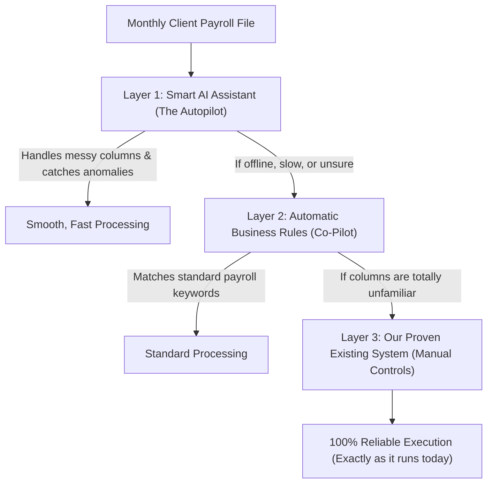

# Upgrading HRS: Smarter, Faster Payroll with a 100% Safety Guarantee
## Executive Presentation & Business Pitch

**Prepared For:** Executive Leadership, Management & HR Operations  
**Presentation Topic:** Modernizing HRS with Practical AI & Guaranteed Reliability  

---

## 1. The Big Picture (The 30-Second Elevator Pitch)

> *"Right now, managing payroll across 31 different clients requires hours of manual cross-checking, fixing broken spreadsheets, and answering repetitive worker questions.*
> 
> *We are introducing a **Smart Payroll Assistant** into HRS that handles the messy work automatically—reading changing Excel sheets, catching payment mistakes before money leaves the bank, and answering worker payslip inquiries.*
> 
> *Most importantly: **It has a built-in unbreakable safety net.** The AI never replaces our existing system—it works alongside it. If the AI is ever unsure or offline, our trusted current system automatically takes over. Nothing breaks, zero downtime."*

---

## 2. The Problems We Face Today (And What They Cost Us)

| What Happens Today | The Business Impact |
| :--- | :--- |
| **Different clients send different Excel sheets.** If Jay Kay or OFI renames a column or adds a row, the upload fails and requires urgent technical fixes. | Delays in processing, stress at month-end, and wasted administrative hours. |
| **Manual checking for mistakes.** Checking if Petra (Tier 2), SSNIT, and bank account numbers match for hundreds of workers is done manually. | Risk of overpayments, underpayments, penalties from statutory bodies, or bank transfer rejections. |
| **HR inbox flooded with payslip questions.** Workers call or visit HR daily asking: *"Why was GHS 120 deducted?"* or *"Please print my July payslip."* | HR spends up to 40% of their working hours acting as a manual helpdesk instead of focusing on people. |

---

## 3. The Solution: "Smart Payroll" with the 3-Layer Safety Net

To understand how this works, think of modern commercial aircraft:

### The 3 Layers Explained in Plain English:
1. **Layer 1: The Smart Assistant (AI)**  
   Like an experienced payroll clerk, it reads messy client spreadsheets, recognizes what belongs where, and spots unusual pay jumps.
2. **Layer 2: Automatic System Rules (Backup)**  
   If the internet is slow or the AI is unavailable, the system automatically uses strict standard formulas and keywords.
3. **Layer 3: Our Existing Trusted Code (The Ultimate Safety Net)**  
   If all else fails, the system runs the exact code we are using right now today. 

**Guarantee:** The system will **never** stop working or halt payroll because of AI.

---

## 4. Four Core Upgrades Leadership Will See

### 1. "Zero-Panic" Spreadsheet Uploads
* **Before:** Client changes a header from `BASIC SALARY` to `MONTHLY BASE` $\rightarrow$ System crashes or imports empty numbers.
* **Now:** The system recognizes what the column means automatically. HR uploads the file, previews the match with 1 click, and moves on.

### 2. The Pre-Flight Mistake & Fraud Detector
Before anyone approves the payroll or sends money via bank transfer:
* **Salary Spike Alert:** Flags anyone whose pay jumped by $>20\%$ unexpectedly without recorded overtime.
* **Ghost Worker Alert:** Flags if two different employees have the same bank account or mobile money number.
* **Statutory Compliance Check:** Confirms that every active worker has their SSNIT and Petra Tier 2 properly calculated before GRA/SSNIT audits.

### 3. Employee Self-Service on WhatsApp & Web
* Workers can securely message a dedicated WhatsApp number or portal:
  * *"Send me my payslip for September 2026."* $\rightarrow$ Received as a PDF in 3 seconds.
  * *"Why was GHS 118 deducted?"* $\rightarrow$ The assistant explains: *"You had 2 days of unrecorded attendance (absenteeism) and GHS 80 for Petra Tier 2."*
* **Result:** Eliminates 70–80% of repetitive walk-ins and phone calls to HR.

### 4. 1-Minute Executive Answers
Leadership can ask simple questions without requesting custom reports:
* *"What was our total Petra Tier 2 liability across all OFI sites for last quarter?"*
* *"Which client had the highest overtime spend over the last 3 months?"*
* Get instant numbers, totals, and graphs.

---

## 5. Answers to the 4 Hard Questions Leadership Will Ask

### Q1: *"Will this disrupt what is working right now?"*
> **Answer:** **No.** We do not touch or replace the working payroll calculators for any of our 31 clients. The AI is an added helper that sits alongside the existing system. You can even toggle it ON or OFF with a single switch.

### Q2: *"Is our employee data secure?"*
> **Answer:** **100% yes.** In strict accordance with Ghana's Data Protection Act (Act 843), we never send employee names, phone numbers, or bank account numbers to any external AI. Only column titles and anonymized numbers are checked.

### Q3: *"What if the internet is down at month-end?"*
> **Answer:** The system automatically uses Layer 2 and Layer 3 (our offline rules and current codebase). Month-end payroll will **never** be delayed by an internet outage.

### Q4: *"How will we roll this out?"*
> **Answer:** We test it first on just **one client** (e.g. Jay Kay or OFI) in "Silent Mode" (where it runs in the background and reports its accuracy without changing any numbers). Only after management sees 100% accuracy will we turn it on live.

---

## 6. Ready-to-Use Meeting Script for Presenting

Here is a simple, powerful script you can speak directly in your meeting:

---

> *"Good morning / afternoon everyone,*
>
> *I want to share an exciting step forward for our HR and Payroll platform.*
>
> *As you know, managing 31 different client payrolls every month takes an enormous amount of manual effort. Each client formats their Excel differently, errors in statutory deductions or bank details have to be caught by hand, and our HR team spends days answering payslip questions.*
>
> *We have designed an upgrade that brings modern AI into HRS to do the heavy lifting:*
> 1. *It automatically understands changing client spreadsheets so imports never fail.*
> 2. *It acts as an automatic auditor, spotting double bank accounts or pay mistakes before money is sent.*
> 3. *It lets workers get their payslips and answers to deduction questions directly on WhatsApp, freeing up our HR staff.*
>
> *Most importantly, we built this with an **unbreakable safety net**:*
> *The AI works alongside our current system, not in place of it. If the AI is ever unsure or offline, our existing trusted system takes over instantly. Zero risk, zero disruption.*
>
> *We want to start with a silent test on one client next week so leadership can see the results firsthand before we expand it.*
>
> *I would love to open the floor to any questions."*

---

## 7. Next Steps

1. **Approve the Pilot**: Select 1 client (e.g., **Jay Kay** or **OFI**) for the test run.
2. **Run in Silent Mode**: Let the smart assistant run alongside the next payroll upload to prove that it matches 100% of the numbers with zero errors.
3. **Review & Expand**: Show leadership the accuracy report and decide together on enabling the employee WhatsApp assistant.
