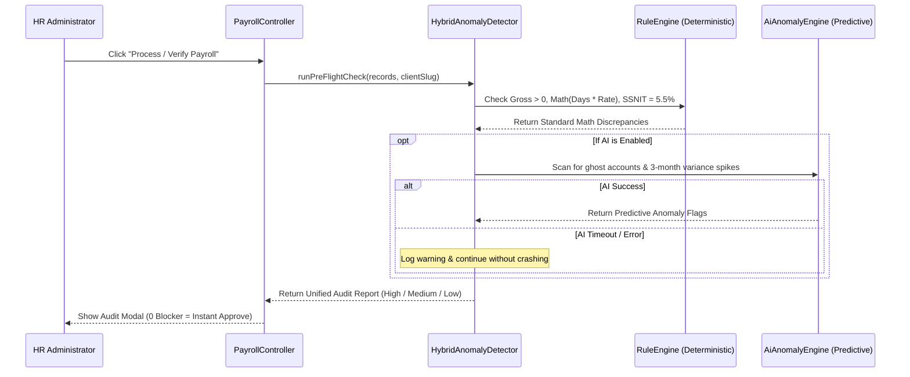

# HRS (Payroll & HR Management System)
## Technical Specification: Hybrid AI Integration Architecture with Graceful Fallback

**Document Version:** 1.0  
**Date:** October 15, 2026  
**System:** HRS (Human Resource & Payroll Management System)  
**Target Stack:** Laravel 11 / PHP 8.2, MySQL 8, Inertia.js (React / TypeScript), DomPDF  

---

## 1. Executive Summary & Objective

The primary objective of this integration is to augment the existing **HRS** platform with artificial intelligence without altering, breaking, or risking existing operations across all **31 active client payrolls**.

### Core Guiding Principles:
1. **Zero Disruption (Side-by-Side Coexistence)**: The current production controllers (`JaykayPayController`, `TranssionPayController`, `MelcomPayController`, `OfibwhPayController`, etc.) remain fully functional.
2. **Graceful Fallback (`if / else` Dual-Engine)**: Every AI-powered process is wrapped in a fail-safe execution pattern. If an AI call fails, times out, experiences rate limits, or returns low-confidence output, the system seamlessly and invisibly falls back to deterministic rule matching, and ultimately to legacy hardcoded column positions.
3. **Data Privacy & Statutory Compliance**: PII (Personally Identifiable Information) is scrubbed or tokenized prior to any external LLM processing, ensuring compliance with Ghana's **Data Protection Act, 2012 (Act 843)**.
4. **Gradual Opt-In Rollout**: Feature-flags enable running AI in "shadow mode" (dry-run logging) or per-client activation before full deployment.

---

## 2. The 3-Tier Dual-Engine Pattern

To guarantee 100% uptime, all enhanced workflows follow a **3-tier hierarchical resolution model**:

```mermaid
flowchart TD
    Start([Excel File Uploaded]) --> Tier1{Tier 1: AI Engine Enabled & Responding?}
    
    Tier1 -- Yes --> AI_Process[Execute AI Schema / Anomaly Model]
    AI_Process --> AI_Check{Confidence Score >= Threshold (85%)?}
    AI_Check -- Yes --> Success_AI[Use AI Match & Apply Cache]
    AI_Check -- No / Low Confidence --> Tier2[Tier 2: Deterministic Rule Matcher]
    Tier1 -- No (Timeout / Exception / Offline) --> Tier2
    
    Tier2 --> Rule_Check{Rule Regex / Fuzzy Match Succeeded?}
    Rule_Check -- Yes --> Success_Rule[Use Rule-Based Match]
    Rule_Check -- No --> Tier3[Tier 3: Legacy Hardcoded Column Index Array]
    
    Tier3 --> Final[Process Payroll Ingestion]
    Success_AI --> Final
    Success_Rule --> Final
```

### Tier Breakdown

| Tier | Component | Description | Failure Handling |
| :--- | :--- | :--- | :--- |
| **Tier 1 (Primary)** | **AI Engine** | LLM-powered context parser (Gemini / Claude / Local LLM) identifying non-standard headers, messy formatting, and subtle mathematical anomalies. | Any network drop, API error, or low confidence ($< 0.85$) immediately triggers Tier 2 without throwing user-facing errors. |
| **Tier 2 (Secondary)** | **Rule & Fuzzy Matcher** | Deterministic keyword and regex dictionary matching Ghanaian payroll conventions (`basic`, `days`, `absent`, `tonnage`, `petra`, `ssnit`, `paye`). | If a column cannot be matched via keyword dictionary, triggers Tier 3. |
| **Tier 3 (Safety Net)** | **Legacy Index Map** | The exact hardcoded column indices currently running in production controllers (e.g. `$row[0]` = Staff ID, `$row[4]` = Basic, `$row[28]` = Petra). | Guaranteed baseline behavior; identical to pre-AI system behavior. |

---

## 3. Architecture & Service Layer Design

Rather than modifying 168 individual controller files directly, we introduce a decoupled service layer under `app/Services/AI/` and `app/Services/Payroll/`.

### 3.1 Directory Structure
```
app/
├── Services/
│   ├── AI/
│   │   ├── Contracts/
│   │   │   ├── ColumnMatcherInterface.php
│   │   │   └── AnomalyDetectorInterface.php
│   │   ├── GeminiAiClient.php
│   │   └── AiPayloadSanitizer.php
│   └── Payroll/
│       ├── ColumnMatcher/
│       │   ├── HybridColumnMatcher.php      <-- Core if/else orchestrator
│       │   ├── AiColumnMatcher.php          <-- Tier 1
│       │   ├── RuleBasedColumnMatcher.php   <-- Tier 2
│       │   └── LegacyColumnMatcher.php      <-- Tier 3
│       ├── Anomaly/
│       │   ├── HybridAnomalyDetector.php
│       │   └── RuleBasedAnomalyDetector.php
│       └── DynamicIngestionService.php
```

---

## 4. Detailed Implementation Blueprint

### 4.1 Interface Definitions

#### `app/Services/AI/Contracts/ColumnMatcherInterface.php`
```php
<?php

namespace App\Services\AI\Contracts;

interface ColumnMatcherInterface
{
    /**
     * Resolves raw spreadsheet headers into standardized internal keys.
     *
     * @param array $headers List of raw string headers from row 1/2 of Excel
     * @param string $clientSlug e.g., 'jaykay', 'ofitemp', 'melcom'
     * @return array [ 'field_name' => column_index ]
     */
    public function match(array $headers, string $clientSlug): array;
}
```

---

### 4.2 The Hybrid Orchestrator (`if/else` Implementation)

#### `app/Services/Payroll/ColumnMatcher/HybridColumnMatcher.php`
```php
<?php

namespace App\Services\Payroll\ColumnMatcher;

use App\Services\AI\Contracts\ColumnMatcherInterface;
use App\Models\ClientPayrollConfig;
use Illuminate\Support\Facades\Log;
use Throwable;

class HybridColumnMatcher implements ColumnMatcherInterface
{
    public function __construct(
        protected AiColumnMatcher $aiMatcher,
        protected RuleBasedColumnMatcher $ruleMatcher,
        protected LegacyColumnMatcher $legacyMatcher
    ) {}

    public function match(array $headers, string $clientSlug): array
    {
        // 0. CHECK CACHE / CONFIG FIRST
        // If an administrator already approved this client's mapping for this layout, reuse it
        $savedMapping = ClientPayrollConfig::getApprovedMapping($clientSlug, $headers);
        if ($savedMapping) {
            return $savedMapping;
        }

        // ==============================================================
        // TIER 1: TRY AI MATCHER
        // ==============================================================
        if (config('ai.enabled') && config("ai.clients.{$clientSlug}.enabled", true)) {
            try {
                Log::channel('payroll_ai')->info("Attempting AI column match for: {$clientSlug}");
                
                $aiResult = $this->aiMatcher->match($headers, $clientSlug);

                if (!empty($aiResult['mapping']) && ($aiResult['confidence'] ?? 0) >= config('ai.min_confidence', 0.85)) {
                    Log::channel('payroll_ai')->info("AI match successful for {$clientSlug} (Confidence: {$aiResult['confidence']})");
                    
                    // Auto-record mapping for admin review
                    ClientPayrollConfig::recordSuggestion($clientSlug, $headers, $aiResult['mapping'], 'ai');
                    
                    return $aiResult['mapping'];
                }

                Log::channel('payroll_ai')->warning("AI match low confidence for {$clientSlug}. Falling back to Rule Matcher.");
            } catch (Throwable $e) {
                // Network failure, API timeout, quota exhaustion, or parsing error
                Log::channel('payroll_ai')->error("AI column match failed for {$clientSlug}: {$e->getMessage()} - Falling back to Rule Matcher.");
            }
        }

        // ==============================================================
        // TIER 2: TRY RULE-BASED / REGEX FUZZY MATCHER
        // ==============================================================
        try {
            $ruleResult = $this->ruleMatcher->match($headers, $clientSlug);
            
            if (!empty($ruleResult) && count($ruleResult) >= 10) {
                Log::info("Rule-based column match succeeded for: {$clientSlug}");
                ClientPayrollConfig::recordSuggestion($clientSlug, $headers, $ruleResult, 'rule');
                return $ruleResult;
            }
        } catch (Throwable $e) {
            Log::warning("Rule matcher failed for {$clientSlug}: {$e->getMessage()} - Falling back to Legacy.");
        }

        // ==============================================================
        // TIER 3: GUARANTEED SAFETY NET (LEGACY HARDCODED POSITIONS)
        // ==============================================================
        Log::info("Using Tier 3 Legacy hardcoded column indices for: {$clientSlug}");
        return $this->legacyMatcher->match($headers, $clientSlug);
    }
}
```

---

### 4.3 Rule-Based Matcher (`Tier 2`)
Contains a deterministic Ghanaian payroll dictionary to resolve columns even without an internet connection:

```php
<?php

namespace App\Services\Payroll\ColumnMatcher;

class RuleBasedColumnMatcher
{
    protected array $dictionary = [
        'staff_id'      => ['/staff\s*id/i', '/emp(loyee)?\s*id/i', '/id\s*no/i', '/badge/i'],
        'name'          => ['/full\s*name/i', '/employee\s*name/i', '/name/i'],
        'basic_salary'  => ['/basic\s*sal(ary)?/i', '/base\s*pay/i', '/monthly\s*rate/i', '/basic/i'],
        'days_worked'   => ['/days\s*worked/i', '/work(ing)?\s*days/i', '/actual\s*days/i', '/total1/i'],
        'daily_rate'    => ['/daily\s*rate/i', '/rate\s*per\s*day/i', '/tonnage\s*rate/i'],
        'ssnit_ee'      => ['/ssnit\s*(5\.5%|ee|emp)/i', '/ssf\s*ee/i', '/tier\s*1\s*ee/i'],
        'petra'         => ['/petra/i', '/tier\s*2/i', '/provident\s*fund/i', '/5%\s*petra/i'],
        'paye'          => ['/p\.?a\.?y\.?e\.?/i', '/income\s*tax/i', '/gra\s*tax/i'],
        'net_pay'       => ['/take\s*home/i', '/net\s*pay/i', '/net\s*salary/i', '/final\s*pay/i'],
    ];

    public function match(array $headers, string $clientSlug): array
    {
        $mapping = [];

        foreach ($headers as $index => $header) {
            $headerClean = trim((string)$header);
            if (empty($headerClean)) continue;

            foreach ($this->dictionary as $field => $patterns) {
                if (isset($mapping[$field])) continue; // Already mapped

                foreach ($patterns as $pattern) {
                    if (preg_match($pattern, $headerClean)) {
                        $mapping[$field] = $index;
                        break 2;
                    }
                }
            }
        }

        return $mapping;
    }
}
```

---

### 4.4 Legacy Matcher (`Tier 3`)
Preserves the exact existing array offsets currently in your production controllers:

```php
<?php

namespace App\Services\Payroll\ColumnMatcher;

class LegacyColumnMatcher
{
    public function match(array $headers, string $clientSlug): array
    {
        // Returns the exact indices currently in production:
        return match ($clientSlug) {
            'jaykay' => [
                'staff_id'      => 0,
                'name'          => 1,
                'position'      => 2,
                'basic_salary'  => 4,
                'legalworkdays' => 5,
                'daily_rate'    => 6,
                'days_worked'   => 7,
                'absent_ded'    => 9,
                'gross_salary'  => 20,
                'ssnit_ee'      => 27,
                'petra'         => 28,
                'taxable_income'=> 29,
                'paye'          => 30,
                'net_pay'       => 34,
            ],
            'ofitemp', 'ofibwh' => [
                'staff_id'      => 0,
                'name'          => 1,
                'rate'          => 2,
                'days'          => 3,
                'gross'         => 4,
                'ssnit'         => 5,
                'petra'         => 6,
                'paye'          => 7,
                'net'           => 8,
            ],
            // Default 0..N layout
            default => range(0, count($headers) - 1),
        };
    }
}
```

---

## 5. Pre-Flight Payroll Anomaly & Fraud Engine

Before payslips are generated or bank lists are exported, the system executes an automated audit.



### Checks Performed:
1. **Ghost Account Detection**: Multiple distinct Staff IDs pointing to the exact same bank account or MoMo number.
2. **Gross Pay Spike ($>20\%$)**: Flags any employee whose earnings jumped significantly compared to the prior 2 months without logged overtime.
3. **Statutory Deduction Discrepancies**:
   * Employee has gross earnings $> 0$ but $0.00$ SSNIT or Petra Tier 2.
   * Petra deduction is not within $\pm 0.05$ of $\text{Basic} \times 0.05$.
4. **Ghanaian Minimum Wage Violations**: Daily rate below the national daily statutory wage.

---

## 6. Configuration & Feature Flags

All AI functionality is managed via Laravel's native configuration and `.env` files. If an administrator wishes to disable AI entirely, it is toggled with a single variable without restarting the application:

### `.env`
```env
# Master AI Kill-Switch (true = enabled with fallback, false = rule-only)
AI_PAYROLL_ENABLED=true

# AI Provider: 'gemini', 'anthropic', 'openai', or 'local'
AI_PROVIDER=gemini
AI_API_KEY=AIzaSy...your-gemini-key

# Resilience & Timeouts
AI_REQUEST_TIMEOUT_SECONDS=4
AI_MIN_CONFIDENCE_THRESHOLD=0.85

# Dry Run Mode: If true, logs AI decisions but executes rule/legacy results
AI_DRY_RUN_MODE=false

# Specific Feature Switches
AI_FEATURE_COLUMN_MATCHING=true
AI_FEATURE_ANOMALY_DETECTION=true
AI_FEATURE_COPILOT=false
```

### `config/ai.php`
```php
<?php

return [
    'enabled' => env('AI_PAYROLL_ENABLED', false),
    'dry_run' => env('AI_DRY_RUN_MODE', false),
    'provider' => env('AI_PROVIDER', 'gemini'),
    'api_key' => env('AI_API_KEY'),
    'timeout' => env('AI_REQUEST_TIMEOUT_SECONDS', 4),
    'min_confidence' => env('AI_MIN_CONFIDENCE_THRESHOLD', 0.85),
    
    // Per-client granular override
    'clients' => [
        'jaykay'    => ['enabled' => true],
        'ofitemp'   => ['enabled' => true],
        'ofibwh'    => ['enabled' => true],
        'transsion' => ['enabled' => true],
    ],
];
```

---

## 7. Data Privacy & Compliance Safeguards

To comply with the **Data Protection Act (Act 843)** of Ghana:

1. **Zero Employee Names Sent to External LLM**:
   When matching columns, the system transmits **only header strings** (e.g. `["STAFF ID", "BASIC", "DAYS", "PETRA"]`), never employee names, phone numbers, or account numbers.
2. **Tokenized Anomaly Detection**:
   When checking for multi-month salary spikes, numerical values are anonymized:
   * Sent to AI: `{"id": "EMP_001", "avg_m1": 1500, "avg_m2": 1520, "current": 3200}`
   * Withheld: Full Name, Bank Account Number, Home Address, Ghana Card PIN.

---

## 8. Integration Example: Updating Existing Controller with Zero Risk

Here is how an existing controller (e.g. [`JaykayPayController.php`](file:///home/khelly/Music/hrs/app/Http/Controllers/JaykayPayController.php)) adopts the hybrid matcher in just a few lines while preserving its existing logic:

```php
// Inside JaykayPayController::upload()
public function upload(Request $request, HybridColumnMatcher $matcher)
{
    $request->validate([
        'file' => ['required', 'file', 'mimes:xlsx,xls', 'max:2048'],
        'month' => ['required', 'date_format:Y-m'],
    ]);

    // ... Load Excel file as before ...
    $rows = $sheet->toArray();
    $rawHeaders = array_shift($rows); // Row 1 headers

    // RESOLVE COLUMNS: Uses AI -> Rule Matcher -> Legacy fallback
    $cols = $matcher->match($rawHeaders, 'jaykay');

    foreach ($rows as $index => $row) {
        // Extract values via resolved columns (guaranteed safe)
        $staff_id     = trim($row[$cols['staff_id']] ?? '') ?: null;
        $name         = trim($row[$cols['name']] ?? '') ?: null;
        $basic_salary = is_numeric($row[$cols['basic_salary']] ?? '') ? (float)$row[$cols['basic_salary']] : null;
        $days_worked  = is_numeric($row[$cols['days_worked']] ?? '') ? (float)$row[$cols['days_worked']] : null;
        $ssnit_ee     = is_numeric($row[$cols['ssnit_ee']] ?? '') ? (float)$row[$cols['ssnit_ee']] : null;
        $petra        = is_numeric($row[$cols['petra']] ?? '') ? (float)$row[$cols['petra']] : null;
        $take_home    = is_numeric($row[$cols['net_pay']] ?? '') ? (float)$row[$cols['net_pay']] : null;

        // ... Continues exactly as before ...
    }
}
```

---

## 9. Rollout & Validation Plan

| Stage | Action | Success Criteria |
| :--- | :--- | :--- |
| **Stage 1: Shadow / Dry-Run Mode** | Deploy `HybridColumnMatcher` with `AI_DRY_RUN_MODE=true`. System logs AI outputs vs legacy outputs side-by-side. | 0 crashes; AI matches or exceeds legacy accuracy on historical months. |
| **Stage 2: Single-Client Pilot** | Enable active AI matching exclusively on **Jay Kay** or **OFI**. | Real uploads process correctly; invalid spreadsheets are automatically diagnosed. |
| **Stage 3: Pre-Flight Anomaly Pilot** | Enable rule-based + AI anomaly audits prior to payslip generation. | Catches known edge cases (e.g. missing Petra Tier 2) with zero false-positives blocking payroll. |
| **Stage 4: General Availability** | Roll out across all 31 clients with centralized logging and one-click admin override. | Reduced upload errors and total elimination of manual column troubleshooting. |

---

## 10. Summary

This architecture gives HRS the power and speed of modern AI without introducing operational fragility:
* If the AI is up, you get **intelligent auto-matching** and **predictive fraud checks**.
* If the AI is down or slow, the system **automatically degrades to rule-based matching and legacy code** with zero interruption to payroll.
